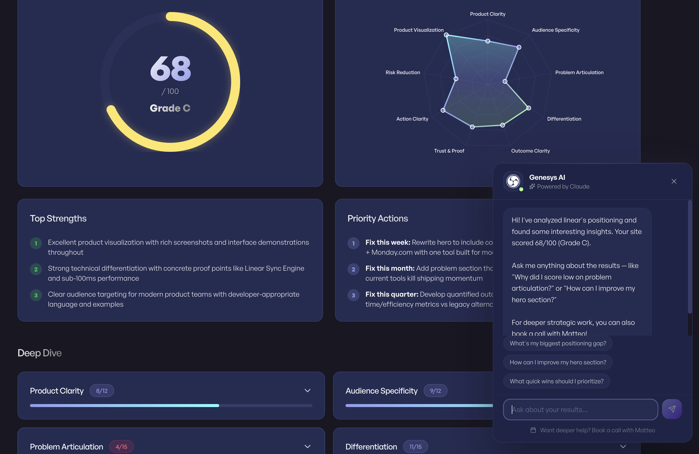
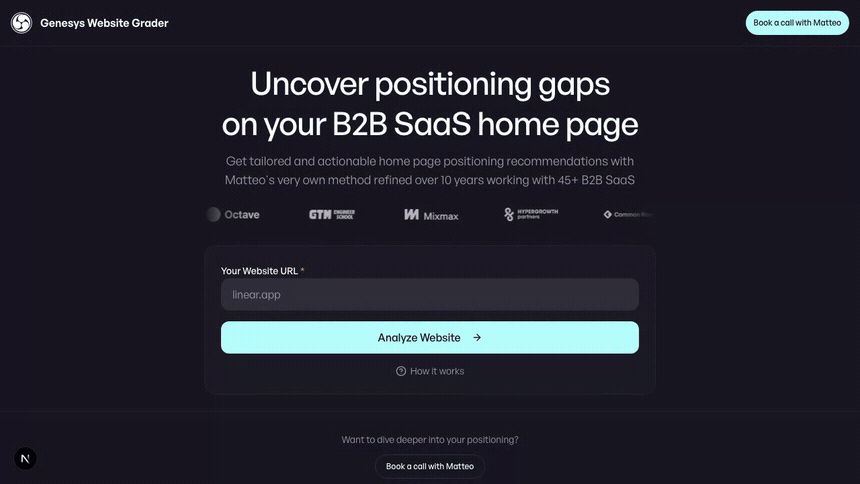

<p align="center">
  
</p>

# Genesys Website Grader

[](LICENSE)
[](https://nextjs.org)
[](#quick-start)
[](https://www.linkedin.com/in/matteo-titta/)

**Score any B2B SaaS home page 0–100 in about 15 seconds.** Enter a URL and get a product-marketing grade across ten positioning dimensions — each with the evidence behind the score and specific fixes. It runs the same method I use with clients, as a single Claude pass over the page.

Built by [Matteo Titta](https://www.linkedin.com/in/matteo-titta/) · [Genesys Growth](https://genesysgrowth.com)

## Demo

<p align="center">
  
</p>

## What it does

You paste a home page URL. The app fetches it, then asks Claude to grade it against a ten-dimension positioning rubric and returns:

- A **0–100 score and a letter grade** (A–F).
- A **per-dimension breakdown** — the score, the evidence that earned it, and concrete fixes.
- A **radar chart** and an executive summary you can share or export to PDF.
- An optional **submissions log** — every grade appends a row to a Google Sheet you own.

## Quick start

Runs keyless out of the box — no API keys, no Google sign-in, no database. In development it uses a mock session and returns a deterministic sample scorecard, so you can see the whole flow before wiring anything up.

```bash
git clone https://github.com/matteotitta/genesys-website-grader.git
cd genesys-website-grader
npm install
npm run dev
```

Open [http://localhost:3000](http://localhost:3000), enter a URL (try `linear.app`), and grade it. You'll get a sample score in demo mode.

## Configuration

Copy the template and fill in only what you need — every value is optional:

```bash
cp .env.example .env.local
```

| Variable | What it enables |
|---|---|
| `ANTHROPIC_API_KEY` | Real scoring. Without it, the app returns a sample scorecard (demo mode). |
| `GOOGLE_SHEETS_WEBHOOK_URL` | Log each submission to a Google Sheet (see below). |
| `AUTH_SECRET`, `GOOGLE_CLIENT_ID`, `GOOGLE_CLIENT_SECRET` | Real Google sign-in (used for lead capture in production). |
| `FIRECRAWL_API_KEY` | Cleaner page extraction. Falls back to a built-in scraper. |
| `XAI_API_KEY` | Grok fallback if Anthropic returns a billing error. |
| `GOOGLE_WEB_RISK_API_KEY` | Extra URL-safety layer. Safety checks still run without it. |

In development, Google sign-in is skipped by default so you can run keyless. To test real sign-in locally, set `DEV_NO_AUTH=false` and `NEXT_PUBLIC_DEV_NO_AUTH=false`. The bypass can never be active in a production build.

## Log submissions to Google Sheets

Submissions go to a Google Sheet through a Google Apps Script web app — no service account, no database, and the only secret is one deploy URL.

1. Create a Google Sheet.
2. **Extensions → Apps Script**. Delete the placeholder and paste [`google-apps-script.gs`](google-apps-script.gs).
3. **Deploy → New deployment → Web app**. Execute as **Me**, access **Anyone**. Authorize, then copy the `/exec` URL.
4. Put it in `.env.local` as `GOOGLE_SHEETS_WEBHOOK_URL`.

Each graded site appends a row: timestamp, URL, total score, grade, per-dimension scores, the model used, and the lead's name and email when signed in.

## How the score works

The grade is one Claude pass against a rubric of ten dimensions that sum to 100. It's the "does this page answer the questions a buyer is actually asking" test.

| Dimension | Points | The question it answers |
|---|---|---|
| Product clarity | 12 | What is this? |
| Audience specificity | 12 | Is this for me? |
| Problem articulation | 14 | Do they understand my pain? |
| Differentiation | 14 | Why this over the alternatives? |
| Outcome clarity | 14 | What will I actually get? |
| Trust & proof | 10 | Why should I believe them? |
| Action clarity | 8 | How do I get started? |
| Risk reduction | 6 | What could go wrong? |
| Pricing clarity | 5 | How much? |
| Product visualization | 5 | Can I see it? |

Grades: **A** 85–100 · **B** 70–84 · **C** 55–69 · **D** 40–54 · **F** below 40.

## Deploy

It's a standard Next.js app — Vercel is the easy path. Set `ANTHROPIC_API_KEY`, `AUTH_SECRET`, `GOOGLE_CLIENT_ID` / `GOOGLE_CLIENT_SECRET` (for sign-in), and `GOOGLE_SHEETS_WEBHOOK_URL` in the project's environment. Do **not** set `DEV_NO_AUTH` in production — the keyless bypass is development-only.

## Tech

Next.js 16 (App Router) · React 19 · Tailwind CSS v4 · shadcn/ui · NextAuth · Anthropic Claude · Recharts · General Sans. Styled with the [Genesys](https://genesysgrowth.com) design system — ink `#181723`, mint `#BAFDFF`, General Sans.

## License

MIT © 2026 Matteo Titta. See [LICENSE](LICENSE).
